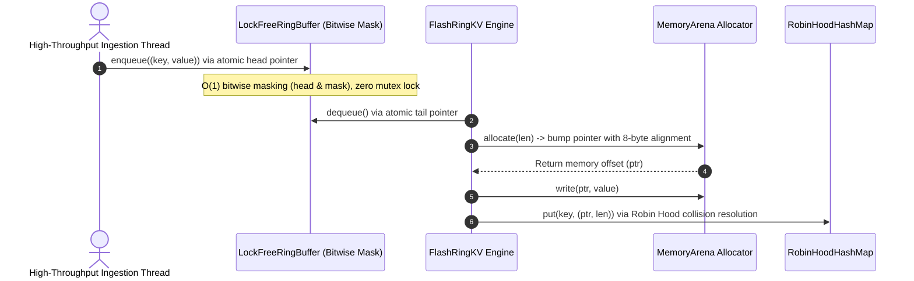

# 🏛️ FlashRing-KV Architecture & Systems Specification

This document provides a formal systems engineering specification of **FlashRing-KV**.

---

## 1. Memory Layout & Cache Sympathy

```
   ┌─────────────────────────────────────────────────────────┐
   │              RobinHoodHashMap (Flat Array)              │
   │  [Slot 0]  Hash: 0x4A... | Dist: 0 | Ptr: 0x0000 | L: 48│
   │  [Slot 1]  Hash: 0x8F... | Dist: 1 | Ptr: 0x0030 | L: 48│  <-- Sequential Cache Lines
   │  [Slot 2]  Hash: 0x12... | Dist: 0 | Ptr: 0x0060 | L: 48│
   └─────────────────────────────┬───────────────────────────┘
                                 │
                 (Pointer Offset into Contiguous Chunk)
                                 ▼
   ┌─────────────────────────────────────────────────────────┐
   │               MemoryArena (Aligned Bytes)               │
   │  [0x0000 - 0x002F] Value Bytes (48 bytes, 8-byte align) │
   │  [0x0030 - 0x005F] Value Bytes (48 bytes, 8-byte align) │
   │  [0x0060 - 0x008F] Value Bytes (48 bytes, 8-byte align) │
   │  [0x0090 ......  ] Free Unfragmented Contiguous Memory  │
   └─────────────────────────────────────────────────────────┘
```

---

## 2. Ingestion Pipeline & Lock-Free Queue



---

## 3. Algorithmic Complexity

| Component | Operation | Time Complexity | Spatial Memory Locality |
| :--- | :--- | :--- | :--- |
| `MemoryArena` | Allocate | $O(1)$ | High (Contiguous Buffer) |
| `MemoryArena` | Deallocate All | $O(1)$ | High (Reset Pointer) |
| `RobinHoodHashMap` | Point Get | $O(1)$ (Bounded) | High (Flat Arrays) |
| `RobinHoodHashMap` | Insertion | $O(1)$ Expected | High (Sequential Linear Probing) |
| `LockFreeRingBuffer` | Enqueue / Dequeue | $O(1)$ | High (Circular Power-of-Two Array) |
